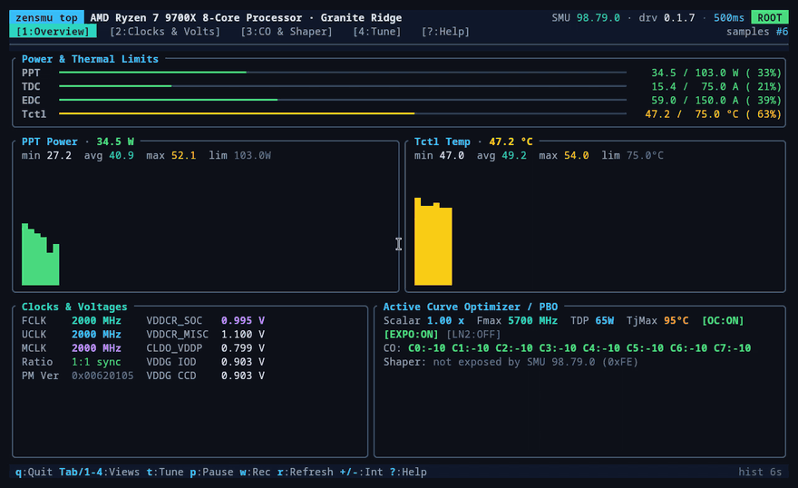
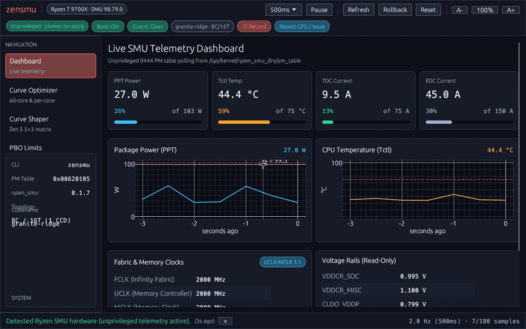

# zensmu

[](https://github.com/brauliobo/zensmu/actions/workflows/ci.yml)
[](https://github.com/brauliobo/zensmu/releases)
[](https://aur.archlinux.org/packages/zensmu-bin)
[](LICENSE)

**Safety-first Rust CLI, live TUI (`zensmu top`), and unprivileged desktop GUI (`zensmu-gui`) for AMD Ryzen SMU control and telemetry on Linux.**

Runs directly on the stock [`ryzen_smu`](https://gitlab.com/leogx9r/ryzen_smu) kernel module (`/sys/kernel/ryzen_smu_drv`) — no custom kernel fork required.

### Live TUI (`zensmu top`)

<p align="center">
  
</p>

### Desktop GUI (`zensmu-gui`)

<p align="center">
  
</p>

---

## Highlights

- **Three native interfaces in one workspace:** scriptable CLI (`zensmu`, with `--json`), `btop`-style live monitor + interactive tuner (`zensmu top`), and an unprivileged WCAG-validated `egui` desktop GUI (`zensmu-gui`).
- **Safety-first SMU transport:**
  - Defeats `ryzen_smu 0.1.7`'s `smu.c:213` false-OK bug via **read-only SMN RSP register verification** + **read-after-write verification**.
  - Serializes every 5-step sysfs transaction with cross-process `flock` (`/run/lock/zensmu.lock`).
  - Cross-checks `/sys/kernel/ryzen_smu_drv/codename` against live `CPUID` family/model/stepping and refuses unverified codenames or unknown PM tables (`> 4096 B` rejected).
  - **Harvested-core discovery:** automatically probes active silicon core slots on 6-core / 12-core dies (e.g. Ryzen 5 5600X, 5600G, 7600X, 9600X) so Curve Optimizer never hits fused-off cores.
  - **Dead-man's switch (`--confirm-within`), `--dry-run` previews, automatic snapshots/rollback, and boot-loop crash guard.**
- **Unprivileged telemetry & narrow privilege elevation:** `zensmu telemetry`, `zensmu top` (read-only), and `zensmu-gui` run as your normal user; `zensmu-gui` elevates narrowly via PolicyKit (`pkexec /usr/bin/zensmu ... --json`) only when requested. Running `sudo zensmu ...` automatically invokes `modprobe ryzen_smu` if the module isn't loaded yet.
- **Full Desktop & Mobile APU limit support:** Curve Optimizer (per-core, all-core, iGPU), Zen 5 15-point Curve Shaper, PBO (`PPT`, `TDC`, `EDC`, `Tctl`, `Scalar`, `Fmax`), and APU DPTC (`STAPM`, `Fast`, `Slow`, `APU Slow`, `SoC TDC/EDC`, `APU/dGPU Skin Temp`, `STAPM/Slow Time`, `Max Performance` / `Power Saving`), plus one-command `systemd` boot & suspend-resume persistence.

---

## Install

### 1. Kernel Driver (`ryzen_smu`)

`ryzen_smu` is an out-of-tree DKMS kernel module (not bundled in official Debian/Ubuntu/Fedora/Arch repos). `zensmu` does not hard-depend on it so installations never break on custom kernels, automatically runs `modprobe ryzen_smu` when invoked as root, and includes built-in `zensmu driver status|load|install` tooling:

- **Arch Linux / CachyOS** — install **`ryzen_smu-dkms-git`** (underscore `_`, not `ryzen-smu-dkms`):
  ```bash
  paru -S ryzen_smu-dkms-git
  ```
- **Debian / Ubuntu** — run `sudo zensmu driver install` (auto-downloads & SHA256-verifies `ryzen-smu-dkms_*_all.deb` from [Releases](https://github.com/brauliobo/zensmu/releases)), or install manually:
  ```bash
  # Option A: automatic verified DKMS .deb install
  sudo zensmu driver install

  # Option B: manual .deb install from Releases
  sudo apt install linux-headers-$(uname -r) ./ryzen-smu-dkms_*_all.deb

  # Option C: build directly from upstream amkillam/ryzen_smu via DKMS
  sudo apt install dkms git build-essential linux-headers-$(uname -r)
  git clone https://github.com/amkillam/ryzen_smu.git /tmp/ryzen_smu
  sudo make -C /tmp/ryzen_smu dkms-install && sudo modprobe ryzen_smu
  ```
- **Fedora / RHEL / openSUSE** — run `sudo zensmu driver install` (auto-downloads & SHA256-verifies `ryzen-smu-dkms-*.noarch.rpm` from [Releases](https://github.com/brauliobo/zensmu/releases)), or install manually:
  ```bash
  # Option A: automatic verified DKMS .rpm install
  sudo zensmu driver install

  # Option B: manual .rpm install from Releases
  sudo dnf install kernel-devel-$(uname -r) ./ryzen-smu-dkms-*.noarch.rpm
  # (openSUSE: sudo zypper install --allow-unsigned-rpm ./ryzen-smu-dkms-*.noarch.rpm)

  # Option C: build directly from upstream amkillam/ryzen_smu via DKMS
  sudo dnf install dkms git gcc make kernel-devel-$(uname -r)
  git clone https://github.com/amkillam/ryzen_smu.git /tmp/ryzen_smu
  sudo make -C /tmp/ryzen_smu dkms-install && sudo modprobe ryzen_smu
  ```

> **Secure Boot / MOK signing:** Out-of-tree DKMS modules like `ryzen_smu` cannot load unsigned when UEFI Secure Boot or kernel lockdown (`integrity`/`confidentiality`) is active. Enroll your DKMS Machine Owner Key (`sudo mokutil --import /var/lib/dkms/mok.pub` and reboot to complete enrollment) or disable Secure Boot in UEFI firmware. Run `zensmu driver status` to inspect Secure Boot and lockdown status.

### 2. Install `zensmu`

#### APT Repository (Debian / Ubuntu — Auto-Updates)

Hosted on GitHub Pages ([`https://brauliobo.github.io/zensmu/apt/`](https://brauliobo.github.io/zensmu/)):

```bash
echo "deb [trusted=yes] https://brauliobo.github.io/zensmu/apt ./" | sudo tee /etc/apt/sources.list.d/zensmu.list
sudo apt update
sudo apt install zensmu

# Optional: install the out-of-tree ryzen_smu DKMS kernel driver
sudo apt install linux-headers-$(uname -r) ryzen-smu-dkms
```

#### RPM / DNF Repository (Fedora / RHEL / openSUSE — Auto-Updates)

Hosted on GitHub Pages ([`https://brauliobo.github.io/zensmu/rpm/`](https://brauliobo.github.io/zensmu/)):

```bash
# Fedora / RHEL (DNF)
curl -fsSL https://brauliobo.github.io/zensmu/rpm/zensmu.repo | sudo tee /etc/yum.repos.d/zensmu.repo
sudo dnf install zensmu
# Optional: sudo dnf install kernel-devel-$(uname -r) ryzen-smu-dkms

# openSUSE (Zypper)
sudo zypper addrepo --no-gpgcheck https://brauliobo.github.io/zensmu/rpm zensmu
sudo zypper refresh
sudo zypper install --allow-unsigned-rpm zensmu
# Optional: sudo zypper install --allow-unsigned-rpm kernel-default-devel ryzen-smu-dkms
```

A Fedora COPR RPM spec is also maintained in [`packaging/copr/zensmu.spec`](packaging/copr/zensmu.spec) for source-built COPR / `rpmbuild` packages.

#### AUR, Direct Packages & Source Build

Prebuilt packages for **Debian/Ubuntu (`.deb`)**, **Fedora/RHEL/openSUSE (`.rpm`)**, **Arch/CachyOS (`.pkg.tar.zst`)**, and generic Linux (`.tar.gz`) — plus optional `ryzen-smu-dkms` `.deb`/`.rpm` packages — are published automatically on every [GitHub Release](https://github.com/brauliobo/zensmu/releases):

```bash
# Arch Linux / CachyOS (AUR)
paru -S zensmu-bin     # prebuilt binary
paru -S zensmu-git     # build from main

# Debian / Ubuntu (direct .deb from Releases)
sudo apt install ./zensmu_*_amd64.deb

# Fedora / RHEL / openSUSE (direct .rpm from Releases)
sudo dnf install ./zensmu-*.x86_64.rpm
```

Or build from source (Rust 1.78+):

```bash
git clone https://github.com/brauliobo/zensmu.git && cd zensmu
cargo build --release --workspace
```

All packages install `zensmu`, `zensmu-gui`, the desktop launcher (`zensmu-gui.desktop` + `zensmu.svg` icon), the `zensmu.1` man page (`man zensmu`), `zensmu-apply.service`, `zensmu-record.service` and `zensmu-exporter.service` (unprivileged user daemons), the `systemd-sleep` resume hook, the PolicyKit rule (`org.zensmu.policy`), and `bash`/`zsh`/`fish` completions.

---

## Quick Usage

### Live TUI & Desktop GUI

```bash
zensmu top                # Unprivileged live telemetry dashboard
sudo zensmu top           # Full live monitor + interactive [4:Tune] & [P] boot persistence
zensmu-gui                # Unprivileged desktop GUI (elevates via pkexec only on demand)
```

In `zensmu top`: `1`–`4` switch tabs (`Overview`, `Clocks & Volts`, `CO & Shaper`, `Tune`), `←/→` or `h/l` adjust limits, `a`/`Enter` opens the dry-run preview modal, `w`/`W` starts/stops live telemetry recording and cycles format (`CSV`/`JSONL`/`PTS`), `P` persists live settings + enables boot/resume service, `R` rolls back, `?` shows all keys.

### CLI Essentials

```bash
# Diagnostics & driver management
zensmu driver status                               # Inspect ryzen_smu module, DKMS, autoload & distro guidance
sudo zensmu driver install                         # Auto-install verified ryzen-smu-dkms (.deb/.rpm) or DKMS source
zensmu info                                        # CPU, CPUID, topology, capabilities
sudo zensmu doctor                                 # Driver, false-OK mitigation, mailbox ping, guard check
sudo zensmu status                                 # Live telemetry + CO + Shaper + PBO + factory limits
zensmu telemetry --json                            # Unprivileged PM table telemetry

# Curve Optimizer & Zen 5 Curve Shaper
sudo zensmu co get
sudo zensmu co set --all -20 --dry-run             # Preview exact mailbox/opcode/args first
sudo zensmu co set --all -20 --confirm-within 30   # Auto-rollback if unconfirmed within 30s
sudo zensmu co set --core 0=-15,1=-15,2..5=-25     # Per-core offsets (harvested-core safe)
sudo zensmu co set --igpu -10                      # iGPU CO (supported CPUs/APUs)
sudo zensmu shaper set --freq high --temp med=-15  # Zen 5 5x3 Curve Shaper

# Desktop PBO & Mobile APU DPTC limits
sudo zensmu pbo set --ppt 105W --tdc 80A --edc 150A --tctl 85C --scalar 1 --fmax 5550
sudo zensmu apu set --stapm 25W --fast 35W --slow 28W --tdc-soc 15A --apu-skin 70C --mode max-performance

# Per-core Curve Optimizer stability tester / core-cycler (aliases: `test`, `bench`)
zensmu test --duration 30s --workload mixed          # Pin self-verifying stress worker per core (mixed|integer|floating-point|cache)
sudo zensmu bench --duration 60s --workload cache --rollback-on-fail  # Auto-rollback CO on MCE or compute error

# Prometheus / OpenMetrics telemetry exporter (unprivileged HTTP /metrics on 127.0.0.1:9452)
zensmu export --listen 127.0.0.1:9452                # Serve live /metrics and /healthz in foreground
zensmu export service enable                         # Enable background user daemon (zensmu-exporter.service)

# Record telemetry over time (unprivileged — CSV, JSONL, or Phoronix Test Suite composite.xml)
zensmu record --interval 1s --duration 10m --tag co-20 -o run.csv
zensmu record --interval 1s --pts-name ryzen-co20    # Writes ~/.phoronix-test-suite/test-results/ryzen-co20/composite.xml
zensmu record export-pts run.csv --pts-name ryzen-co20
zensmu record service enable                         # Enable background user daemon (zensmu-record.service, rotating CSV)

# Rollback, reset & boot/resume persistence
sudo zensmu rollback                                 # Restore last pre-change snapshot
sudo zensmu reset                                    # Zero CO / Curve Shaper back to defaults
sudo zensmu persist save --enable                    # Save live state to /etc/zensmu/active.toml + enable boot/resume service
sudo zensmu persist status                           # Inspect active profile, module autoload, service, and boot guard
sudo zensmu profile clear-guard                      # Clear boot-loop crash guard after relaxing an unstable profile

# Report untested CPUs / PM tables or bugs (privacy-safe — no hostnames, usernames, or serials)
zensmu report --open                               # Open prefilled GitHub issue in browser
sudo zensmu report --raw-pm-table --create         # Collect full probes + PM floats and open via gh CLI
```

> **Soft vs. hard safety bounds:** Conservative soft floors/ceilings (e.g., CO `-35` on Zen 4/5, `-25` on Zen 3; PPT `230 W`) require `--allow-extreme` interactively. Hardware ceilings (such as the `95 °C` Tctl cap) cannot be bypassed.

---

## Supported CPUs & Capabilities

Unsupported or unverified codenames are explicitly refused rather than guessed. For full CPUID family/model mappings, supported PM table versions, and hardware validation status, see the **[Hardware Support Matrix (`docs/HARDWARE_MATRIX.md`)](docs/HARDWARE_MATRIX.md)**.

| Generation | Codenames | Curve Optimizer | iGPU CO | Curve Shaper | PBO Limits | PBO Scalar | Fmax | Fused Limits | APU DPTC |
| :--- | :--- | :---: | :---: | :---: | :---: | :---: | :---: | :---: | :---: |
| **Zen 5 Desktop** | Granite Ridge (Ryzen 9000) | R/W (`-50..+50`) | R/W | R/W* | W | R/W | R/W | R | — |
| **Zen 4 Desktop / HEDT** | Raphael (Ryzen 7000), Storm Peak (TR 7000) | R/W (`-50..+50`) | R/W | — | W | R/W | R/W | R | — |
| **Zen 3 Desktop / HEDT** | Vermeer (Ryzen 5000), Chagall (TR 5000) | R/W (`-30..+30`) | — | — | W | R/W | R | — | — |
| **Zen 2 Desktop / HEDT** | Matisse (Ryzen 3000), Castle Peak (TR 3000) | — | — | — | W | R/W | R | — | — |
| **Zen / Zen+ Desktop / HEDT** | Summit Ridge, Pinnacle Ridge, Colfax, Threadripper | — | — | — | W | R/W | — | — | — |
| **Zen 5 Mobile APUs** | Strix Point, Strix Halo | R/W (`-50..+50`) | R/W | — | W | R/W | R/W | R | W |
| **Zen 4 Mobile APUs** | Phoenix, Hawk Point | R/W (`-50..+50`) | R/W | — | W | R/W | R/W | R | W |
| **Zen 3+ Mobile APUs** | Rembrandt | R/W (`-30..+30`) | R/W | — | W | R/W | R/W | R | W |
| **Zen 3 Mobile APUs** | Cezanne (Ryzen 5000G/U/H) | R/W (`-30..+30`) | R/W | — | W | R/W | R | R | W |
| **Zen 2 Mobile APUs** | Renoir, Lucienne, Van Gogh (Steam Deck) | W (Van Gogh) | — | — | W | R/W | R | R | W |
| **Zen / Zen+ Mobile APUs** | Raven Ridge, Raven Ridge 2, Dali, Picasso | — | — | — | W | R/W | R | R (Picasso) | W |

*\*Curve Shaper requires AGESA/SMU firmware that exposes mailbox opcode `0x84`/`0xA6`; when locked (`0xFE`), `zensmu` detects and skips it cleanly.*

---

## Boot & Suspend Persistence + Crash Guard

Ryzen SMU registers reset on reboot and sleep/resume (`S3`/`S0ix`/`S4`). Running `sudo zensmu persist save --enable` (or pressing `P` in `zensmu top` / clicking **Persist Live SMU & Enable Boot Service** in `zensmu-gui`):

1. Exports all writable live settings (filtered by CPU capabilities) to `/etc/zensmu/active.toml`, pinned to `[target].codename` and `physical_cores`.
2. Ensures `/etc/modules-load.d/ryzen_smu.conf` autoloads `ryzen_smu`.
3. Enables `zensmu-apply.service` (which runs with `--boot-guard --settle-secs 15`) alongside the `/usr/lib/systemd/system-sleep/zensmu-resume` hook (`--settle-secs 5`).

If an unstable undervolt causes a freeze or reboot during the settle window, the armed guard sentinel stays on disk and **refuses auto-apply on the next boot** until you relax `/etc/zensmu/active.toml` and run `sudo zensmu profile clear-guard`.

---

## Safety Non-Goals & Disclaimer

`zensmu` intentionally excludes **manual OC VID / static Vcore overrides**, **arbitrary raw SMN writes**, **blind `-f` PM table parsing**, and **running the GUI as root**. Tuning voltage/frequency margins still carries stability risks until stress-tested (e.g. CoreCycler / Y-Cruncher / Prime95). Always preview with `--dry-run` and test with `--confirm-within` before persisting.

MIT License — see [`LICENSE`](LICENSE).
